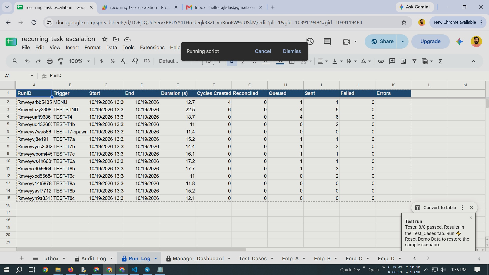
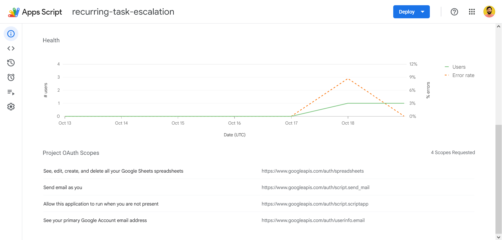
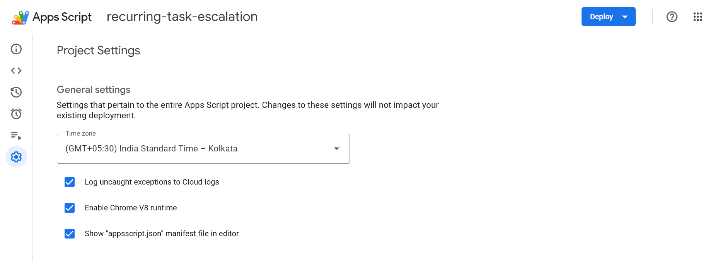

# Task SLA Engine — Recurring Task Tracking, Pending Report & Escalation Automation on Google Sheets

[-4285F4?logo=google&logoColor=white)](https://developers.google.com/apps-script)
[](https://docs.google.com/spreadsheets/)
[](#exactly-once--crash-safety)
[-E91E63)](#exactly-once--crash-safety)
[](#manager-actions--signed-links)
[-00897B)](#configuration)
[](#testing)
[](#screenshots)
[](./LICENSE)

Recurring-task operations automation with **SLA-aware pending detection and escalation**, built on Google Sheets (interface) + Google Apps Script (engine). No servers, no billing — the sheet *is* the app.

For every cycle of every recurring task, the engine:

1. **Spawns** the cycle instance (`CycleID = TaskID + due date`) inside a script lock — re-running a tick can never fork a duplicate cycle.
2. **Collects proof** on the employee's own tab: a ticket ID (regex-validated) for periodic tasks, or that day's HMAC completion code for daily tasks.
3. **Watches the SLA clock** — working days/hours and a holiday calendar decide when each cycle is due, late, and past its deadlines.
4. **Alerts** the manager the same day (L1) through a transactional outbox — queued once under a unique `DedupeKey`, sent, confirmed, retried with backoff.
5. **Escalates** to leadership exactly once per cycle (L2) when the ack or resolve-by deadline passes — and replaces alert spam with one consolidated morning digest.

```text
tick (10 min) → spawn due cycles → sweep employee tabs → SLA clock check ─┬→ L1 manager alert (same day, once)
                                                                          ├→ L2 leadership escalation (once per cycle)
                                                                          └→ 09:30 manager digest (one consolidated mail)
employee tab edit → proof validation → cycle closes → next cycle spawns (+1/7/15/30 days)
        │
        └── Cycle_Log (system of record) · Email_Outbox (queue → send → confirm) · Audit_Log (append-only)
```

---

## Quick start

```bash
git clone https://github.com/rajkdas/recurring-task-sla-automation.git
cd recurring-task-sla-automation
```

**Manual install (~10 minutes):**

1. Create a new Google Sheet (e.g. *Task SLA Engine*).
2. **Extensions → Apps Script**, delete the default `Code.gs` content.
3. Paste the entire contents of [`src/code.gs`](src/code.gs) into that single file — the whole engine lives in one file, organized into ten banner-delimited sections.
4. Project Settings (⚙) → check **Show "appsscript.json"** → paste [`src/appsscript.json`](src/appsscript.json) (timezone `Asia/Kolkata`, explicit OAuth scopes, web app config).
5. Select **`setup`** in the editor → **Run** → approve the authorization prompts.
6. Back in the sheet: replace the placeholder emails in `Config` (manager, leadership, sandbox) and `Task_Master` (employees).
7. Menu **⚡ Task System → Run Engine Tick Now** → the first cycles appear on the employee tabs.

Setup installs two triggers automatically (10-minute engine tick + edit handler).

**clasp (optional, for CLI workflow):**

```bash
npm i -g @google/clasp
clasp login                                        # same Google account as the sheet
cp .clasp.json.example .clasp.json                 # paste your scriptId (Extensions → Apps Script → Project Settings)
clasp push                                         # pushes src/ into the online project (overwrites remote!)
```

---

## Screenshots

**Automated verification — 8/8 scenarios passed, zero failed sends, zero errors** (toast bottom-right; the `Run_Log` behind it shows every test tick at 0 failures / 0 errors):



**Apps Script project dashboard** — health chart and the four granted OAuth scopes (spreadsheets, send mail, run when absent, account email):



**Project settings** — India Standard Time, V8 runtime, manifest file enabled:



---

## Why cycles, not tasks

The core design decision. A recurring "task" is not the thing that gets done or missed — each **cycle instance** is. So the ledger tracks one row per cycle, keyed by `CycleID = TaskID-yyyymmdd(due)`, existence-checked inside `LockService` before insert.

- **State machine**: `SCHEDULED → OPEN → OVERDUE → COMPLETED / COMPLETED-LATE / MISSED`. Closed cycles are immutable — out-of-bound edits are reverted with a toast and a `REJECTED_EDIT` audit row.
- **Reconcile sweep**: if an edit event is ever missed, the next tick reads the proof from the tab and completes the ledger with `Entry Source = RECONCILE` — same validation, no backdoor.
- **One clock**: every read of "now" goes through `getNow()`. Setting `SIMNOW` in `Config` turns weeks of SLA behavior into seconds — that is what the test harness and live demos walk.

---

## Tabs

| Tab | Role |
|---|---|
| `Config` | Every SLA knob: emails, working days/hours, due times, offsets, TestMode, SimNow |
| `Task_Master` | Task registry: assignee, tab, type (`TICKET` / `DAILY_CHECK`), frequency, FIXED/ROLLING, proof regex, SLA profile |
| `Cycle_Log` | **System of record.** One row per cycle instance: full SLA snapshot, who/when/proof, escalation flags |
| `Emp_A…Emp_D` | Employee tabs — the single operating surface (enter Ticket ID / tick Done + paste daily code / remarks) |
| `Alert_Log` | Manager surface: Ack (YES/NO), action (Following up / Reassigned / Extend / Waive), auto Outcome |
| `Email_Outbox` | Transactional outbox: every email queued with a unique `DedupeKey`, then sent and confirmed |
| `Manager_Dashboard` | Pending/overdue per employee, open overdue list, MTTA/MTTR, engine heartbeat |
| `Audit_Log` | Append-only trail of every state change, rejection, alert |
| `Run_Log` | One row per engine tick: duration, counters, errors |
| `Holidays` | Service calendar feeding the working-time math |
| `Test_Cases` | T1–T8 results with evidence, written by the one-click harness |

---

## SLA timeline (working time; weekends/holidays shift automatically)

| Event | DAILY | PERIODIC (7/15/30-day) |
|---|---|---|
| Employee reminder | 10:30 | 14:00 |
| Due | 11:00 | 17:00 |
| L1 manager email | 11:30 same day | 17:30 same day |
| Manager ack deadline | 13:00 | 11:00 next working day |
| Resolve by | 15:00 | 17:00 next working day |
| L2b (no ack + unresolved) | 13:00 | 11:00 next working day |
| L2a (unresolved) | 15:00 | 17:00 next working day |
| Manager digest | 09:30 daily, one consolidated email | same |

Reasoning: daily information decays in hours, so its whole lifecycle must close same-day; periodic portal work earns one working day. Two escalation reasons exist on purpose — **L2b** punishes silent managers (no ack), **L2a** punishes unresolved work (past resolve-by) — and exactly one L2 is sent per cycle with the stronger reason recorded.

---

## Configuration

All policy lives in the `Config` tab as data — the engine never hardcodes a rule. Key keys (defaults shown):

| Key | Default | Meaning |
|---|---|---|
| `MANAGER_EMAIL` | placeholder | L1 alert + digest recipient |
| `LEADERSHIP_EMAILS` | placeholder | L2 escalation recipients (comma-separated) |
| `SANDBOX_EMAIL` | *(blank)* | TestMode recipient; blank = sheet owner |
| `WORKING_DAYS` | `1,2,3,4,5,6` | JS `getDay()` codes: 0=Sun … 6=Sat |
| `WORK_START` / `WORK_END` | 09:00 / 18:00 | Working-time window for SLA math |
| `DAILY_DUE_TIME` / `PERIODIC_DUE_TIME` | 11:00 / 17:00 | When each type is due |
| `REMINDER_OFFSET_DAILY_MIN` / `..._PERIODIC_MIN` | 30 / 180 | Reminder = due − offset |
| `L1_OFFSET_MIN` | 30 | Manager alert = due + offset (working time) |
| `ACK_OFFSET_DAILY_MIN` / `..._PERIODIC_MIN` | 120 / 180 | Ack deadline after due |
| `RESOLVE_OFFSET_DAILY_MIN` / `..._PERIODIC_MIN` | 240 / 540 | Resolve-by after due |
| `DIGEST_TIME` | 09:30 | Daily consolidated digest time |
| `REMINDER_ENABLED` | ON | Toggles employee reminders |
| `EMAIL_ENABLED` | ON | `OFF` = dry-run: outbox marks `SENT-DRY`, nothing is sent |
| `TESTMODE` | OFF | `ON` = all mail routed to the sandbox address with a `[TESTMODE]` prefix |
| `SIMNOW` | *(blank)* | Simulated clock `yyyy-MM-dd HH:mm` — the whole engine reads it |
| `HEARTBEAT_MAX_MIN` | 45 | Dashboard heartbeat staleness threshold |
| `WEBAPP_BASE_URL` | *(blank)* | Enables signed ack/done links once the web app is deployed |

---

## Safe-send email modes

| `EMAIL_ENABLED` | `TESTMODE` | Behavior | When to use |
|---|---|---|---|
| `OFF` | any | Dry-run: outbox rows marked `SENT-DRY`, nothing leaves Gmail | First install, offline demos |
| `ON` | `ON` | Every mail carries a `[TESTMODE]` prefix and lands on `SANDBOX_EMAIL` (or the owner) | Trust-building, screenshots |
| `ON` | `OFF` | Real mail to manager / leadership | Live |

**⚡ Task System → Send Test Email (verify mail)** sends one real message and reports mode + quota — the fastest way to prove Gmail authorization works before any demo.

---

## Manager actions & signed links

Managers work in two places, both writing the same ledger:

- **`Alert_Log`** — set Ack (`YES`/`NO`) and an action (`Following up` / `Reassigned` / `Extend` / `Waive`). Ack is mirrored into `Cycle_Log`; Extend/Waive mutate the cycle with full audit.
- **One-click signed links** (optional) — deploy the script as a Web App (**Deploy → New deployment → Web app**, execute as *Me*, access *Anyone*), paste the URL into `WEBAPP_BASE_URL`. L1/L2 emails then carry a single-use, 24-hour HMAC-signed **Acknowledge** link, and daily reminders a **Mark done** link.

The signed-link feature is deliberately optional — every call goes through a guard (`alertLink_`), and without a deployed web app everything still works from the sheet.

---

## Exactly-once & crash safety

The part reviewers probe first:

- **Detection only queues.** `queueAlert` rebuilds the `DedupeKey` registry from the Outbox at the start of every execution — a duplicate insert is structurally impossible, not just discouraged.
- **Send pipeline**: `QUEUED → SENDING → SENT / FAILED`. Suppression flags are written **after** confirmed send, never before. Retry ×3 with backoff, then an owner alert row.
- **Honest caveat**: MailApp has no delivery receipt, so a crash *during* the send call itself can still duplicate. Mitigation: the `SENDING` state with a 10-minute in-flight window. Documented, not hidden.
- **Single L2 adjudication** at one point per cycle, with reason priority (`past resolve-by` > `unacknowledged`) — two breached deadlines cannot produce two mails.
- **Per-cycle error isolation**: one bad cycle writes a visible `ERROR` row to `Audit_Log` / `Run_Log`; the remaining cycles still get processed.

---

## Logging & audit

- `Run_Log` — one row per tick: durations, created/reconciled/queued/sent/failed counters, first error.
- `Audit_Log` — append-only: every state change, rejection, alert; writes are buffered per execution and flushed at the end for speed.
- `Test_Cases` — PASS/FAIL plus evidence per scenario, written by the harness.

---

## Running it

| Where | How |
|---|---|
| **Setup / Repair Structure** | Builds or repairs all tabs, triggers, formulas, sample tasks (idempotent) |
| **Run Engine Tick Now** | One synchronous engine pass — the demo button |
| **Run All Tests (T1–T8) — fast mode** | Full automated verification |
| **Run Single Test → T1…T8** | One scenario with silent prerequisite replay |
| **Send Test Email (verify mail)** | One real send + mode/quota report |
| **Toggle TestMode** | Flip sandbox routing without touching `Config` |
| **Show Today's Daily Codes** | Reveal today's HMAC codes for daily-task sampling |
| **Reset Demo Data** | Wipe test artifacts, restore the 4 sample tasks |

---

## Testing

**⚡ Task System → Run All Tests (T1–T8).** The harness forces TestMode + email dry-run, builds isolated `TT-*` tasks, walks `SIMNOW` through each SLA stage, asserts dedup across replayed ticks, writes PASS/FAIL + evidence to `Test_Cases`, then cleans up. Each scenario can also run alone with its prerequisites replayed silently. Latest recorded run: **8/8 passed, zero failures** (see [Screenshots](#screenshots)).

| # | Scenario |
|---|---|
| T1 | Recurring cycle: 7-day task closes and next cycle auto-spawns |
| T2 | Single-point completion: ledger gets who/when/proof from one edit |
| T3 | Daily task: wrong code rejected, today's code accepted |
| T4 | Same-day manager alert: exactly one L1 email (deduped across ticks) |
| T5 | Manager acknowledgement is captured and outcome tracked |
| T6 | Leadership escalation: past both deadlines → exactly one L2 email |
| T7 | DAILY timeline walk: reminder → L1 → L2b each fire once |
| T8 | No duplicates: 3 ticks + replayed edits change nothing |

Google-side transient 500s (`We're sorry, a server error occurred…`) can hit any execution before its first log row — re-run that single test; persistent failures are what matter.

---

## Troubleshooting

| Symptom | Cause / fix |
|---|---|
| Test fails with `We're sorry, a server error occurred…` | Google transient 500 (can strike before the first log row). Re-run that test alone; same operations pass inside other tests |
| Authorization prompt loops / `getActiveUser` errors | A stray leftover file in the project, or a hand-edited manifest without `userinfo.email`. Keep only `code.gs` + `appsscript.json`, re-authorize once |
| Outcome column shows `30 Dec 00:00` | Old build formatting an empty Completed At as a date — current builds render `\| open`; refresh via Setup / Repair Structure |
| Outbox stuck at `QUEUED`, no mail | `EMAIL_ENABLED=OFF`, or the time trigger is missing — check the Triggers page; run a manual tick |
| Odd double rows / repeated escalation mails | Old split-file build predating the append-once outbox — replace with the current `code.gs` |
| Duplicate time triggers | Delete extras on the Triggers page; Setup is idempotent |

---

## Architecture / files

```text
recurring-task-sla-automation/
├── README.md
├── LICENSE                      # MIT
├── .gitignore
├── .clasp.json.example          # copy → .clasp.json, paste your scriptId
├── docs/                        # screenshots used by this README
│   ├── test-run-8of8.jpg
│   ├── apps-script-project-details.png
│   └── apps-script-project-settings.png
└── src/
    ├── appsscript.json          # manifest: Asia/Kolkata, V8, explicit oauthScopes, webapp config
    └── code.gs                  # the entire engine — one file, ten banner-delimited sections:
```

Inside `code.gs` (banner order = dependency order):

```text
§00 constants — schema map, column indexes, state machine, config defaults
§01 core      — config service, locks, read caches, buffered audit, batched writers
§02 datetime  — working-time math, holidays, SLA deadline computation
§03 setup     — menu, structure build/repair, triggers, sample data, mail self-test
§04 engine    — tick: spawn cycles, reconcile sweep, missed sweep, dashboard refresh
§05 completion — proof validation (ticket regex / daily HMAC code), completion, next spawn
§06 onedit    — single-point employee edit handler: validate → ledger → audit
§07 alerts    — outbox (append-once queue, send pipeline), L1/L2 detection, digests, ack processor
§08 dashboard — manager dashboard: pending/overdue, MTTA/MTTR, heartbeat (ledger-derived)
§09 tests     — T1–T8 harness, SIMNOW clock walker, single-test runner
§10 webapp    — optional: signed single-use ack/done links (doGet web app)
```

---

## Adapting it to your team

- **New task** = one row in `Task_Master`: assignee, tab, type (`TICKET` or `DAILY_CHECK`), frequency (daily / 7 / 15 / 30), FIXED or ROLLING start, proof regex, SLA profile.
- **Different SLAs** = edit the `Config` offsets; holidays are one row each in `Holidays`.
- **Different proof rule** = change the regex; the daily proof is an HMAC over the date with the sheet's own secret, so codes are predictable only to the sheet.
- **More employees** = one `Emp_*` tab each; the single-operating-surface model holds to dozens of rows per person.
- No policy is in code — every threshold, recipient, and deadline is data, which is what makes the engine reusable beyond the original scenario.

---

## Explicitly left out for v1

Row-level security (Sheets limitation — production path is AppSheet or a web app on the same ledger), WhatsApp Business API proof verification (current design: HMAC attestation + audit sampling; a sheet cannot read WhatsApp), per-user OAuth identity (tab-ownership trust model), push/mobile notifications, multi-sheet sharding for very large teams, analytics warehouse export. Each slots in later without changing the structure above.

---

## License

[MIT](./LICENSE)
